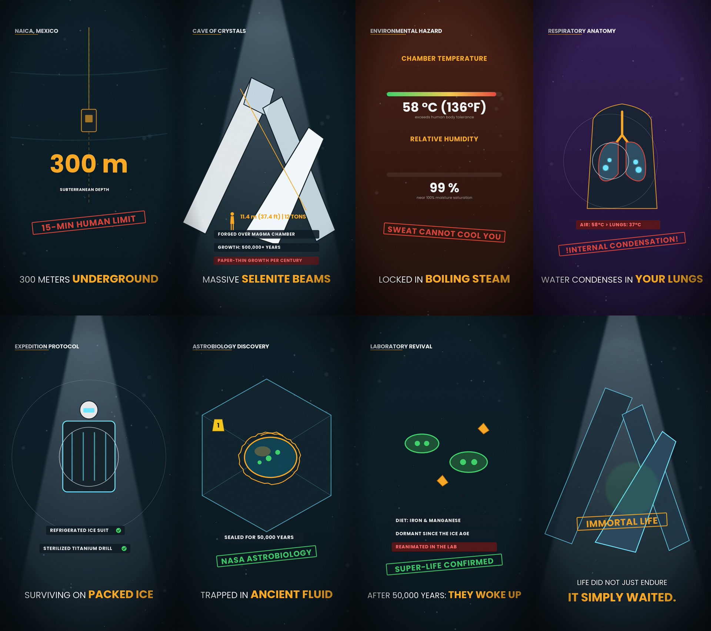

# The Cave of Crystals — 9:16 Vertical Animated Video

Educational explainer animation produced in the **KazChart flat-vector deep-sea / extreme environment style** (dark slate background, god rays, gold/amber and cyan highlights, fact badges, timeline markers, and animated diagrams).

---

## 📥 Direct Download Links

Click below to download the video directly to your PC / Phone:

1. **[Download Full HD 1080x1920 MP4 (19 MB)](https://github.com/Future786/cave-of-crystals-animation/raw/main/The_Cave_of_Crystals_HD_1080x1920.mp4)**
2. **[Download Web / Mobile Compressed MP4 (1.4 MB)](https://github.com/Future786/cave-of-crystals-animation/raw/main/The_Cave_of_Crystals_Compressed.mp4)**

---

## 🎬 Video Information

- **Topic:** The Cave of Crystals (Naica Mine, Chihuahua, Mexico)
- **Niche:** Subterranean & Cave Extremophiles
- **Aspect Ratio:** 9:16 Vertical (Mobile / Shorts / Reels / TikTok)
- **Resolution:** 1080 x 1920
- **Duration:** 78 Seconds
- **Audio:** Custom Dark Ambient Cinematic Audio Bed

---

## 🎙️ Full Narration Script

> "Three hundred meters beneath a Mexican mountain lies a subterranean cathedral that will kill an unprotected human in fifteen minutes. This is the Cave of Crystals, a volcanic chamber where selenite beams stretch up to thirty-seven feet long and weigh twelve tons, forged over half a million years in scalding, mineral-rich groundwater. When miners drained the water, they revealed an environment locked at fifty-eight degrees Celsius and nearly one hundred percent humidity. Here, the air is hotter than your core body temperature, meaning your sweat cannot evaporate, and every breath causes moisture to condense directly inside your cooler lungs. Explorers can only enter wearing custom ice-packed suits, but humans are not the most remarkable thing inside this sweltering vault. Drilling into the core of these glowing translucent pillars, NASA astrobiologists discovered microscopic fluid pockets sealed for up to fifty thousand years. Inside were ancient, dormant microbes that had survived on iron and manganese since the last Ice Age, and when warmed in the laboratory, they woke up. Trapped in a subterranean inferno lethal to us, life did not just endure—it simply waited."

---

## 🖼️ Visual Storyboard & Scene Breakdown

1. **0:00 - 0:08 (Shot 1):** Subterranean Descent (Depth Meter: 300m / 984ft)
2. **0:08 - 0:18 (Shot 2):** Monolith Size Comparison (Human vs 37ft Selenite Crystal)
3. **0:18 - 0:28 (Shot 3):** Lethal Atmosphere (58°C / 99% Humidity warning)
4. **0:28 - 0:38 (Shot 4):** Pulmonary Condensation Anatomy Cutaway (Lungs vs Ambient Air)
5. **0:38 - 0:47 (Shot 5):** Survival Protocol (Ice-packed suit with 15-minute countdown)
6. **0:47 - 0:58 (Shot 6):** NASA Astrobiology Extraction (Crystal inclusion cross-section)
7. **0:58 - 1:09 (Shot 7):** Extremophile Microbe Awakens (50,000-year dormant cell reanimation)
8. **1:09 - 1:18 (Shot 8):** Outro / Fact Pill (Subterranean Extremophiles)
