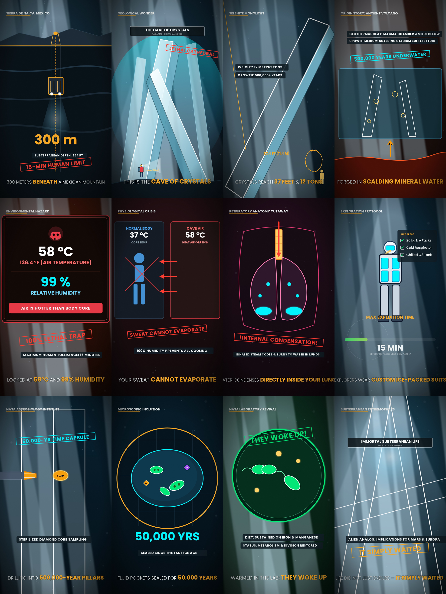

# The Cave of Crystals — 9:16 Vertical Animated Video (Version 2)

Educational explainer animation produced in the **KazChart flat-vector deep-sea / extreme environment style** (dark slate background, god rays, gold/amber and cyan highlights, fact badges, timeline markers, and animated diagrams).

**Now updated with full human voiceover narration, high-contrast vector illustrations, and remastered 12-scene storyboard!**

---

## 📥 Direct Download Links (1-Click Download)

Click below to download directly to your PC / Phone:

1. **[👉 Download Full HD 1080x1920 MP4 (With Voiceover)](https://github.com/Future786/cave-of-crystals-animation/raw/main/The_Cave_of_Crystals_v2_HD.mp4)**
2. **[👉 Download Mobile Compressed 540x960 MP4 (With Voiceover)](https://github.com/Future786/cave-of-crystals-animation/raw/main/The_Cave_of_Crystals_v2_Mobile.mp4)**

---

## 🎬 Video Specifications

- **Topic:** The Cave of Crystals (Naica Mine, Chihuahua, Mexico)
- **Niche:** Subterranean & Cave Extremophiles
- **Aspect Ratio:** 9:16 Vertical (YouTube Shorts, Instagram Reels, TikTok)
- **Resolution:** 1080 × 1920 (Full HD) & 540 × 960 (Mobile)
- **Duration:** 88.5 Seconds (~1 min 28 sec)
- **Audio:** Full Voiceover Narration (BBC Documentary Style) + Cinematic Dark Ambient Music Bed

---

## 🎙️ Full Narration Script

> "Three hundred meters beneath a Mexican mountain lies a subterranean cathedral that will kill an unprotected human in fifteen minutes. This is the Cave of Crystals, a volcanic chamber where selenite beams stretch up to thirty-seven feet long and weigh twelve tons, forged over half a million years in scalding, mineral-rich groundwater. When miners drained the water, they revealed an environment locked at fifty-eight degrees Celsius and nearly one hundred percent humidity. Here, the air is hotter than your core body temperature, meaning your sweat cannot evaporate, and every breath causes moisture to condense directly inside your cooler lungs. Explorers can only enter wearing custom ice-packed suits, but humans are not the most remarkable thing inside this sweltering vault. Drilling into the core of these glowing translucent pillars, NASA astrobiologists discovered microscopic fluid pockets sealed for up to fifty thousand years. Inside were ancient, dormant microbes that had survived on iron and manganese since the last Ice Age, and when warmed in the laboratory, they woke up. Trapped in a subterranean inferno lethal to us, life did not just endure—it simply waited."

---

## 🖼️ Visual Storyboard (12 Scenes)

1. **0:00 - 0:07 (Shot 1):** Subterranean Descent (Depth Meter scans to 300 m / 984 ft)
2. **0:07 - 0:14 (Shot 2):** The Crystal Chamber Reveal (Towering selenite beams & human explorer scale)
3. **0:14 - 0:21 (Shot 3):** Monolith Dimensions (37.4 ft / 12 metric tons / 500,000-year growth)
4. **0:21 - 0:28 (Shot 4):** Boiling Mineral Water Origin (Magma chamber 3 miles below heating hydrothermal water)
5. **0:28 - 0:37 (Shot 5):** Environmental Hazard Dashboard (58°C / 136.4°F & 99% humidity warning)
6. **0:37 - 0:44 (Shot 6):** Physiological Crisis (37°C core body vs 58°C air — sweat cannot evaporate)
7. **0:44 - 0:50 (Shot 7):** Pulmonary Condensation Cutaway (Inhaled boiling steam condenses inside cooler lungs)
8. **0:50 - 0:57 (Shot 8):** The Ice-Suit Protocol (20 kg frozen gel packs, chilled respirator, 15-min limit)
9. **0:57 - 1:04 (Shot 9):** NASA Astrobiology Core Drill (Titanium diamond drill penetrating crystal pillar)
10. **1:04 - 1:12 (Shot 10):** 50,000-Year Fluid Inclusion (Microscopic view of dormant microbes & iron/manganese)
11. **1:12 - 1:19 (Shot 11):** Laboratory Reanimation (Warmed in lab: bacteria wake up and divide!)
12. **1:19 - 1:28 (Shot 12):** Epilogue: Immortal Extremophiles ("Life did not just endure — it simply waited")
