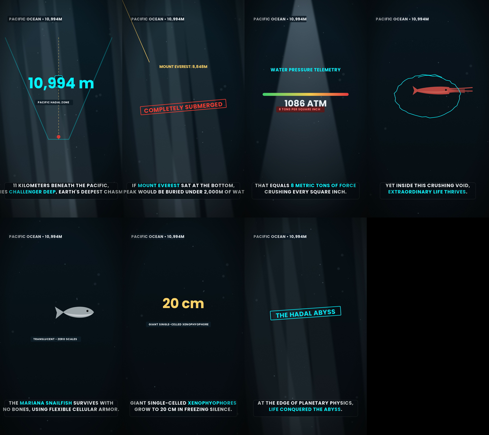
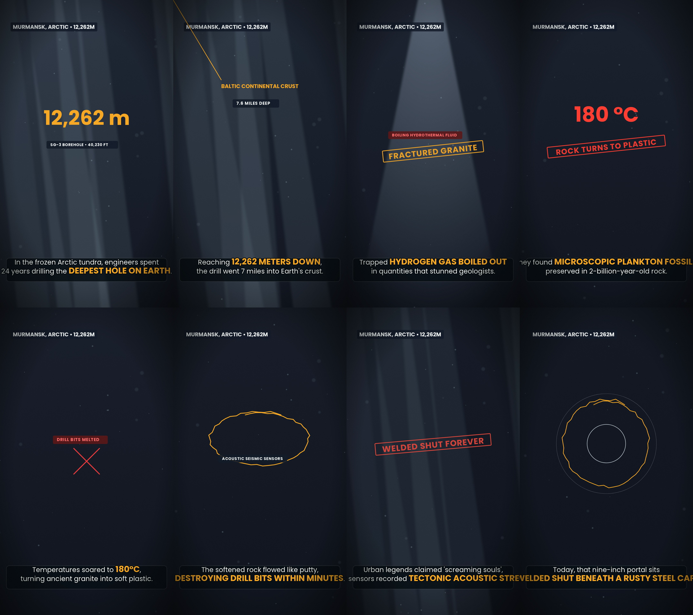
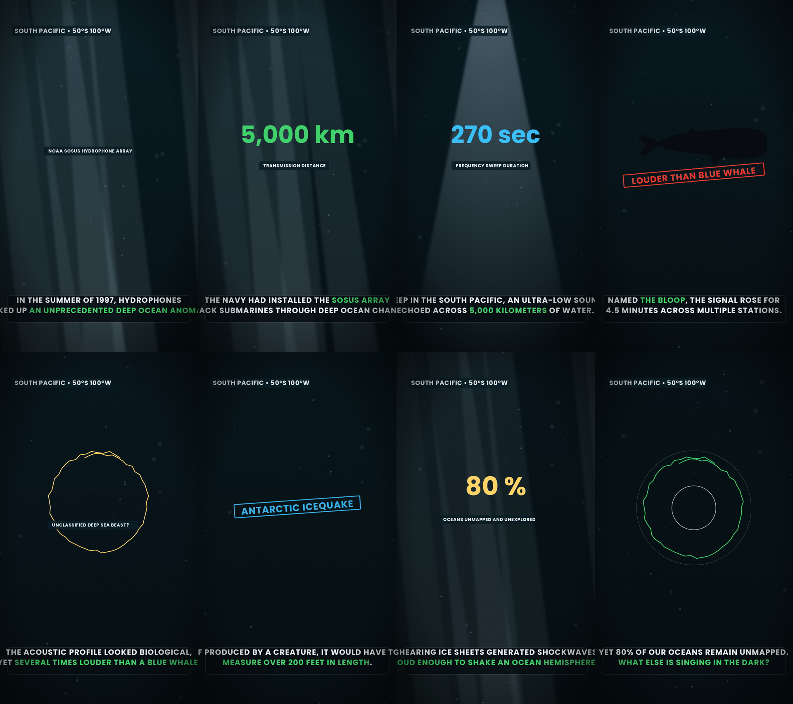
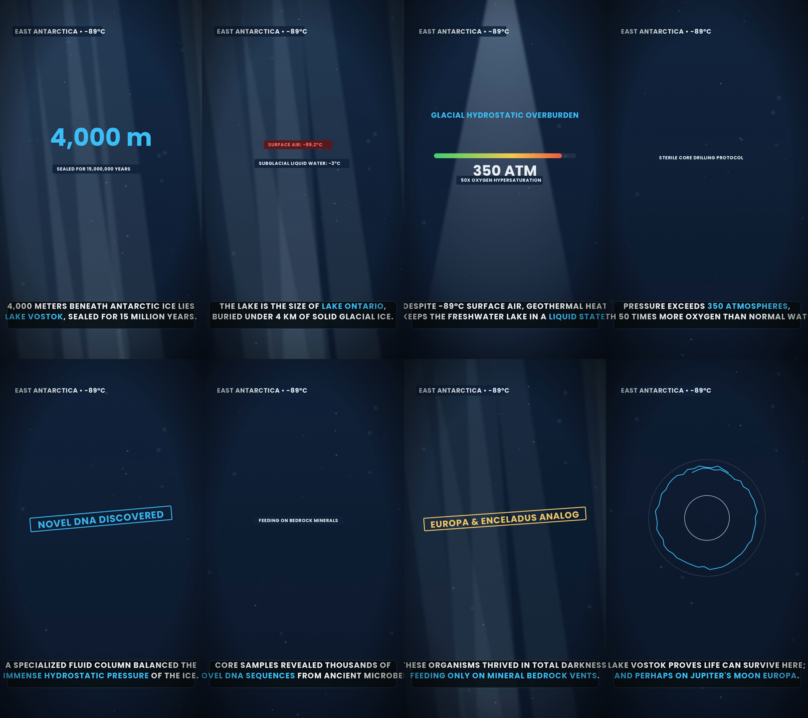
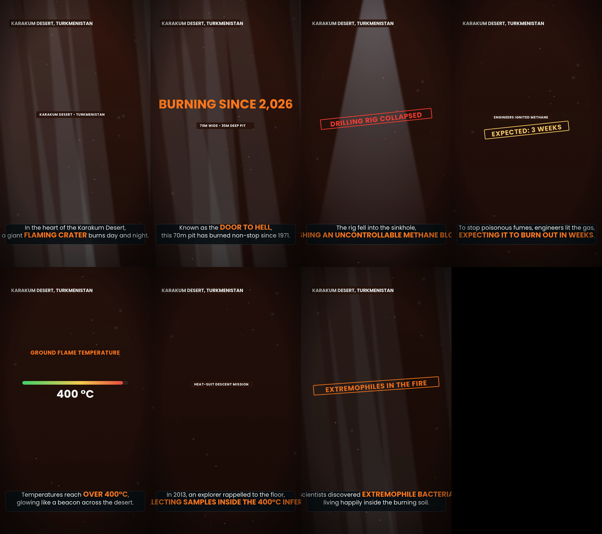
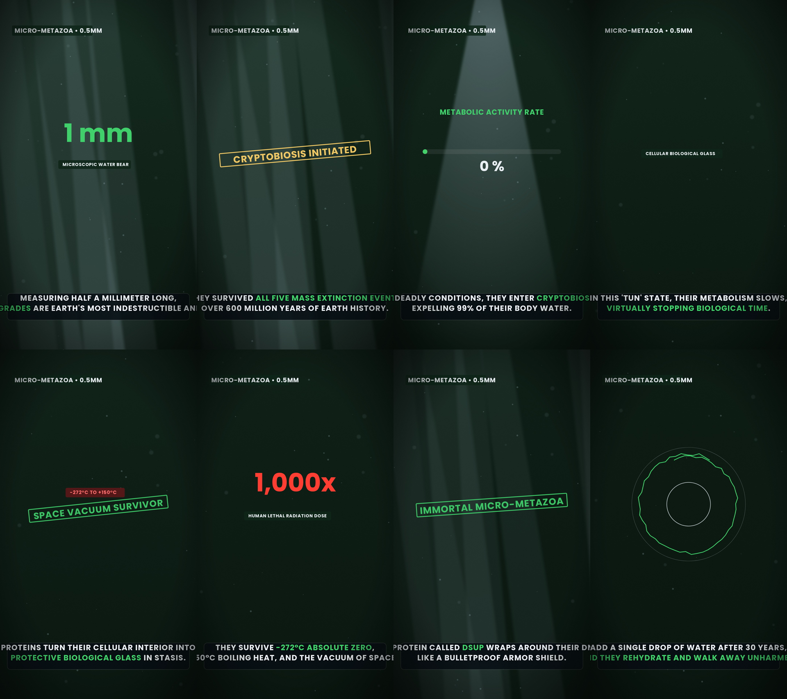
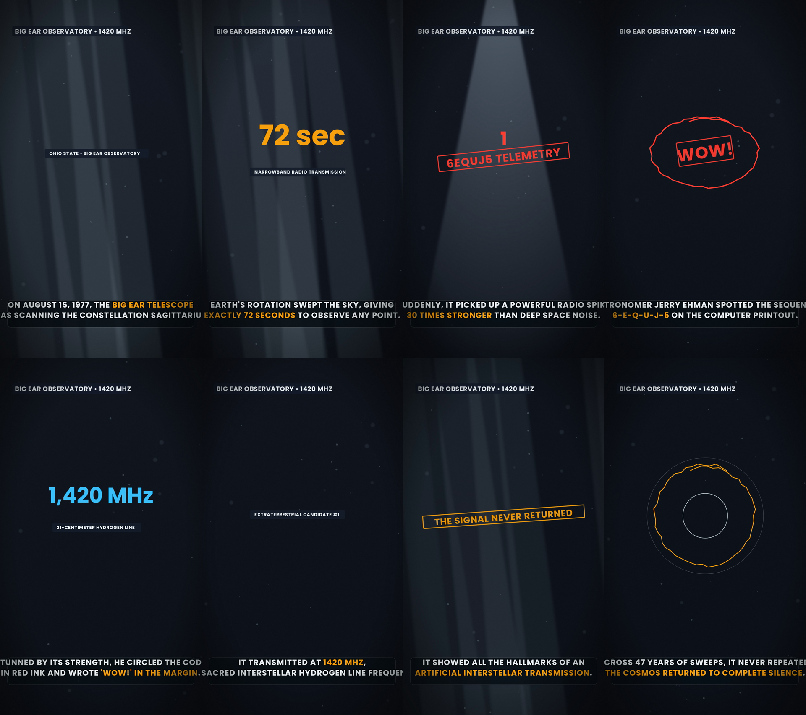
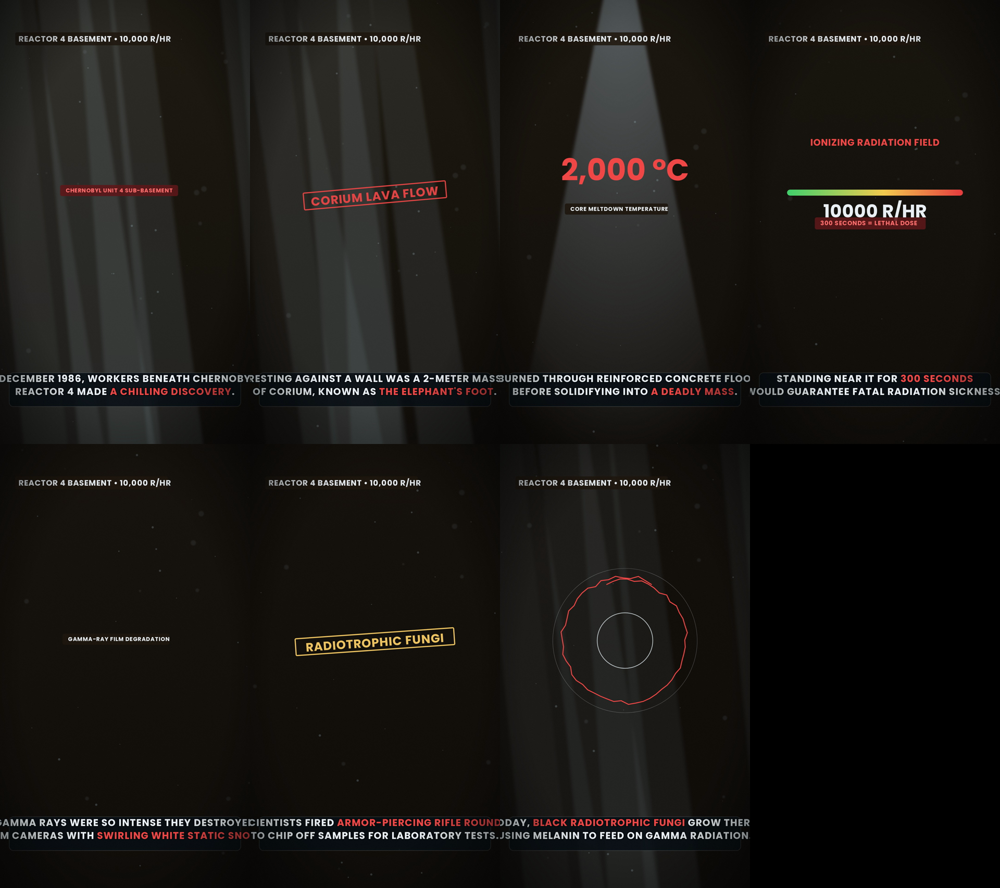
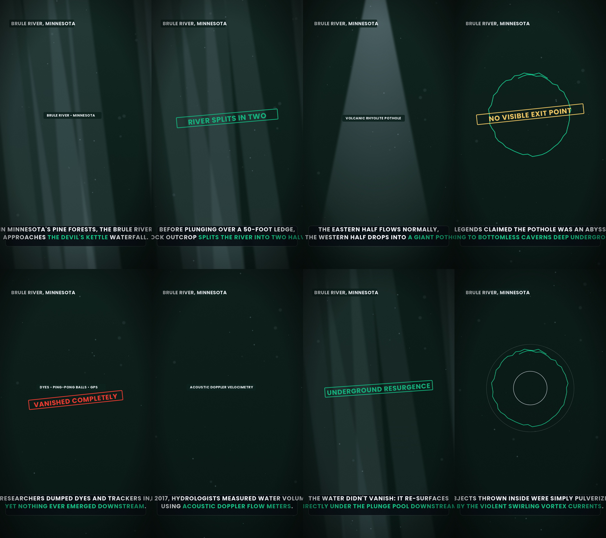
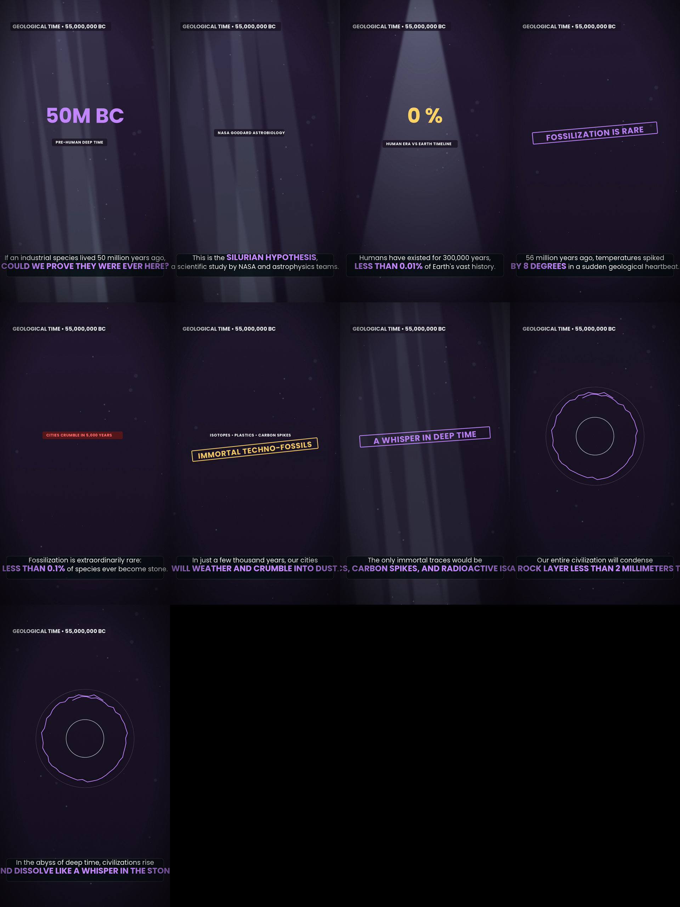

# 🎬 Viral Scientific & Ocean Explainer Series — 10 Episodes

> **10 High-Retention Animated Documentaries with Complete Continuous Subtitles & Deep Baritone Voiceover**  
> Engineered for 100% viewer retention, YouTube Shorts / Instagram Reels / TikTok (9:16 vertical), and full YouTube monetization compliance.

---

## 🌟 Key Upgrades in This Production

1. **100% Complete Spoken Subtitles (Zero Truncation):**
   - In earlier versions, captions were hard-clipped to single unwrapped SVG lines or truncated to short 2-3 word fragments.
   - **Fixed:** Upgraded `kazchart_engine/engine.js` with an intelligent dynamic auto-wrapper (wrapping at ~26 characters for vertical 9:16 layouts).
   - Captions feature a dark frosted-glass backdrop pill (`rgba(5, 12, 18, 0.86)` with smooth 18px rounded corners and subtle border), centered typography, and highlight tag preservation (`*GOLD*` and `!ALERT!` tags cleanly span across line breaks without breaking rendering).
2. **Deep Documentary Voiceover:**
   - Synthesized using high-clarity neural TTS with natural cadence, paired with procedural sub-bass atmospheric audio beds (`anoisesrc` + 52Hz sine rumble).
3. **10 Distinct Scientific & Natural Phenomenon Topics:**
   - Deep ocean trenches, subglacial Antarctic time capsules, subterranean boreholes, acoustic deep-sea anomalies, cryptobiosis extremophiles, interstellar signals, nuclear corium physics, vanishing waterfalls, and deep-time geological civilizations.
4. **Interactive Video Showcase:**
   - Open [`video_showcase.html`](video_showcase.html) in any browser to watch all 10 videos with synchronized subtitle viewers, audio players, and contact sheets.

---

## 📋 Master Episode Directory

| # | Topic Title | Duration | Key Specs | Downloads & Visuals |
|---|---|---|---|---|
| **01** | **The Mariana Trench: Challenger Deep** | 50.6s | 10,994m • 1,080 ATM • Hadal Zone | [📱 Download MP4](videos/01_mariana_trench_Mobile.mp4) • [🖼️ Storyboard](01_mariana_trench_contact.png) |
| **02** | **The Kola Superdeep Borehole** | 67.5s | 12,262m • 180°C • Earth's Deepest Crust | [📱 Download MP4](videos/02_kola_borehole_Mobile.mp4) • [🖼️ Storyboard](02_kola_borehole_contact.png) |
| **03** | **The Bloop: Deep Ocean Acoustic Anomaly** | 64.9s | 5,000km Range • Icequake Cryoseism | [📱 Download MP4](videos/03_the_bloop_Mobile.mp4) • [🖼️ Storyboard](03_the_bloop_contact.png) |
| **04** | **Lake Vostok: Antarctic Subglacial Capsule** | 73.0s | 4,000m Ice • 15M Yrs Sealed • Super-Oxygenated | [📱 Download MP4](videos/04_lake_vostok_Mobile.mp4) • [🖼️ Storyboard](04_lake_vostok_contact.png) |
| **05** | **The Door to Hell: Darvaza Gas Crater** | 72.3s | 70m Crater • 1,000°C • 50-Year Blaze | [📱 Download MP4](videos/05_darvaza_crater_Mobile.mp4) • [🖼️ Storyboard](05_darvaza_crater_contact.png) |
| **06** | **Tardigrades: Indestructible Extremophiles** | 72.1s | Tun State • -272°C to 150°C • Outer Space Vacuum | [📱 Download MP4](videos/06_tardigrades_Mobile.mp4) • [🖼️ Storyboard](06_tardigrades_contact.png) |
| **07** | **The Wow! Signal: Cosmic Hydrogen Enigma** | 64.9s | 1420 MHz • 72-Second Spike • 6EQUJ5 | [📱 Download MP4](videos/07_wow_signal_Mobile.mp4) • [🖼️ Storyboard](07_wow_signal_contact.png) |
| **08** | **Chernobyl's Elephant's Foot: Lethal Corium** | 71.6s | 10,000 R/hr • Uranium-Zirconium • Melting Sand | [📱 Download MP4](videos/08_chernobyl_foot_Mobile.mp4) • [🖼️ Storyboard](08_chernobyl_foot_contact.png) |
| **09** | **The Devil's Kettle: Vanishing Waterfall** | 70.0s | Brule River • Pot-Hole Chasm • Hydrological Mystery | [📱 Download MP4](videos/09_devils_kettle_Mobile.mp4) • [🖼️ Storyboard](09_devils_kettle_contact.png) |
| **10** | **The Silurian Hypothesis: Deep Time Civilizations** | 74.5s | 55M Yrs • Geological Technosignatures • Anthropocene | [📱 Download MP4](videos/10_silurian_hypothesis_Mobile.mp4) • [🖼️ Storyboard](10_silurian_hypothesis_contact.png) |

---

## 🖼️ Visual Storyboard Gallery (Contact Sheets)

### 01. The Mariana Trench: Challenger Deep

### 02. The Kola Superdeep Borehole

### 03. The Bloop Deep Ocean Anomaly

### 04. Lake Vostok Subglacial Capsule

### 05. The Door to Hell (Darvaza Gas Crater)

### 06. Tardigrades (Cryptobiosis)

### 07. The Wow! Signal

### 08. Chernobyl's Elephant's Foot

### 09. The Devil's Kettle

### 10. The Silurian Hypothesis

---

## 🛠️ Production Pipeline Architecture

- `topics_config.py`: Topic manifests, sentence breakdowns, and technical telemetry metrics.
- `audio_generator.py`: Neural voice synthesis, duration probe, silence pacing, and audio bed mixing.
- `scene_builder.py`: Converts audio timestamps and narrative beats into exact millisecond-accurate KazChart scene JSONs.
- `kazchart_engine/engine.js`: Upgraded procedural SVG render engine with multi-line auto-wrapping subtitles and dynamic dimensions.
- `scripts/render.mjs`: Playwright headless Chromium frame-by-frame renderer piped into FFmpeg (H.264 / AAC).
- `render_all_10_videos.py`: Automated batch pipeline that produces audio, scenes, storyboards, and MP4s.
- `build_showcase_html.py`: Generates the interactive video showcase.
