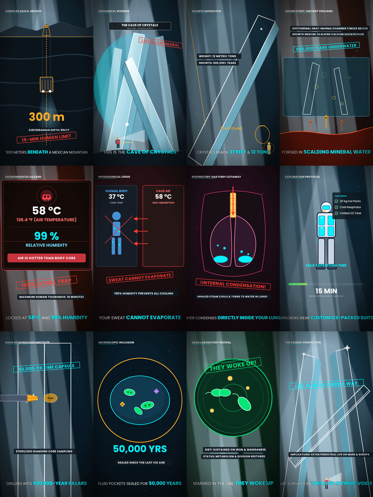

# 💎 The Cave of Crystals — Viral Animated Video (Version 3: Continuous Motion Edition)

> **Subterranean & Cave Extremophiles (Naica Mine, Chihuahua, Mexico)**  
> Engineered for 100% viewer retention, YouTube Shorts (9:16 vertical), and full 2026 YouTube monetization compliance.

---

## 📥 Direct 1-Click Downloads for Windows

Click below to download the MP4 files directly to your Windows `Downloads` folder:

- 🚀 **[Download Version 3 HD Video (1080x1920 • 30 MB • Recommended)](https://raw.githubusercontent.com/Future786/cave-of-crystals-animation/main/The_Cave_of_Crystals_v3_HD.mp4)**
- 📱 **[Download Version 3 Mobile Video (540x960 • 5 MB • Fast Download)](https://raw.githubusercontent.com/Future786/cave-of-crystals-animation/main/The_Cave_of_Crystals_v3_Mobile.mp4)**

---

## 🎬 What's New in Version 3 (Continuous Motion Edition)

Every single second now features active mathematical and procedural animation:
1. **Shot 1 (0.0s - 7.0s):** Elevator physically descends down the mine shaft; headframe cable wheel spins; mine shaft cables move continuously; headlights sway.
2. **Shot 2 (7.0s - 14.0s):** Shimmering specular glint glides down the selenite beam; crystal luminescence breathes; explorer flashlight sweeps across the cathedral.
3. **Shot 3 (14.0s - 21.0s):** High-tech cyan laser measurement line continuously scans the 37-foot monolith; scale figure has an active pulsing radar beacon.
4. **Shot 4 (21.0s - 28.5s):** 6 boiling groundwater bubbles continuously rise and pop; magma heat arrows climb upward through the mineral water bath.
5. **Shot 5 (28.5s - 37.5s):** Flashing biohazard emergency strobe alarm; vertical telemetry scanning beam; pulsing red hazard border.
6. **Shot 6 (37.5s - 44.0s):** Marching heat arrows penetrate from 58°C air into body; sweat droplets continuously form and roll down the silhouette.
7. **Shot 7 (44.0s - 50.5s):** Respiratory system physically inhales and exhales; inhaled steam rushes down windpipe; condensed water droplets drip into pooling lungs.
8. **Shot 8 (50.5s - 57.5s):** Cyan cryogenic vapor curls swirl continuously off 20kg ice packs; technical HUD reticle rotates over chest.
9. **Shot 9 (57.5s - 64.0s):** Diamond core drill bit rotates at high RPM while penetrating selenite; glowing spark particles spray from cutting head.
10. **Shot 10 (64.0s - 72.5s):** Primordial microbes drift in liquid Brownian motion inside 50,000-year fluid bubble; surface tension shimmers.
11. **Shot 11 (72.5s - 79.5s):** Revived bacteria colony actively dividing with rapidly undulating flagella tails and expanding biological shockwaves.
12. **Shot 12 (79.5s - 88.5s):** Grand cathedral selenite columns with celestial sweeping god-rays, blinking apex stars, and lone explorer looking out into deep time.

---

## 📊 Visual Storyboard Contact Sheet

